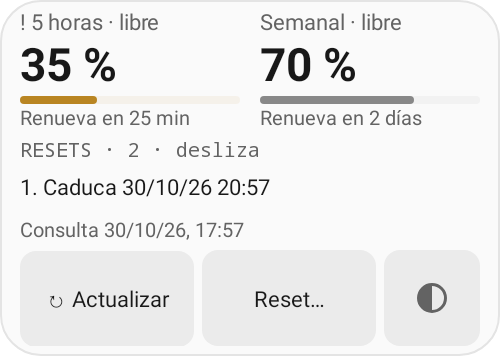

# Cuota Codex

Consulta la cuota de Codex de tu cuenta de ChatGPT desde Android, con widgets, avisos y gestión de resets.

**0.2.0-beta.1 · Android 8.0 o posterior**

## En el móvil

- Cuota restante de cinco horas y semanal, cuando el servicio las proporciona, con sus próximas renovaciones.
- Widgets completo y mini con temas Sistema, Claro, Oscuro y Grafito. Los indicadores de aviso siguen el umbral elegido.
- Resets ordenados por caducidad. Todo canje o reintento exige confirmación, con información para valorar si conviene esperar a la renovación automática.
- Avisos de cuota baja, caducidad de resets y recuperación de cuota. Los umbrales se ajustan con barras; los detalles de diagnóstico se despliegan cuando hacen falta.
- Frecuencia de consulta configurable de 15 minutos a 6 horas y actualización manual. Los datos antiguos se identifican aunque no haya error de conexión.
- Inicio de sesión mediante un código autorizado en el navegador del móvil. No requiere ordenador ni servidor propio.

Android puede retrasar las consultas y los recordatorios para ahorrar batería. El aviso de recuperación solo se genera tras confirmar nuevos datos del servidor. Los recordatorios de caducidad basados en datos guardados indican que se refieren a la última consulta.



Vista generada con Android simulado y datos de ejemplo. Las capturas de la app y del widget mini están en `docs/screenshots/`.

## Instalación de la beta

El [APK firmado](releases/0.2.0-beta.1/codex-quota-0.2.0-beta.1.apk) se instala como **Cuota Codex Beta**, con identificador `es.codexquota.mobile.beta`. Puede convivir con la distribución anterior y tiene sus propios ajustes y sesión. Es necesario iniciar sesión en la beta.

La beta utiliza una nueva identidad de firma. Las siguientes versiones deberán conservarla para poder actualizar esta instalación. No sustituye la instalación `es.codexquota.mobile`. Consulta [compilación y firma](docs/building.md).

## Desarrollo

Proyecto Android convencional con **Kotlin y Java**, Gradle Wrapper y Android Gradle Plugin. Las reglas nuevas de presentación, reintentos y avisos están separadas para poder probarlas sin cuentas reales. El código de la versión anterior se ha recuperado y revisado durante la migración; esta versión ya no se construye a partir de Smali.

Requisitos: JDK 17 o posterior, Android SDK Platform 35 y Build Tools 35.0.0. JDK 21 es la versión de referencia para las comprobaciones.

```sh
./gradlew :app:testDebugUnitTest :app:assembleDebug
```

El APK de desarrollo se genera en `app/build/outputs/apk/debug/`. Para la distribución firmada y las comprobaciones de la beta, véase [compilación](docs/building.md) y [validación](docs/validation.md).

```text
app/src/main/java/        Integración Android, sesión, consultas y pantallas
app/src/main/kotlin/      Reglas Kotlin de comportamiento y presentación
app/src/main/res/         Widgets, iconos, temas y recursos
app/src/test/             Pruebas locales y de integración con Android simulado
docs/                    Arquitectura, compilación y validación
releases/                Distribuciones firmadas y checksums
AGENTS.md                Reglas de mantenimiento
```

## Integración

Cuota Codex es una aplicación independiente, sin afiliación a OpenAI. Se conecta directamente a los servicios de ChatGPT; los endpoints internos de cuota y resets pueden cambiar. La sesión se cifra en el dispositivo con Android Keystore. No se incorporan analítica ni un servidor intermedio.
